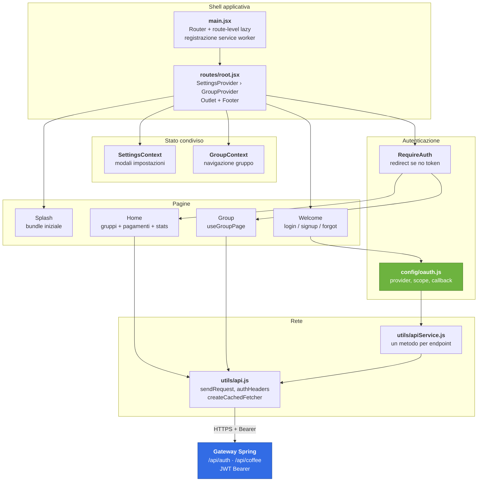

<p align="center">
  
</p>

<h1 align="center">PagaTu — Frontend</h1>

<p align="center">
  <strong>Il caffè che unisce il team.</strong><br />
  Single-page application React per gestire turni, pagamenti e premi<br />
  dei gruppi che si dividono il caffè al bar.
</p>

<p align="center">
  
  
</p>

<p align="center">
  <a href="README.md"></a>
  
  
  
  
</p>

<p align="center">
  
  
  
  
  
  
  
  
</p>

<p align="center">
  
  
  
  
  
  
</p>

---

## Indice

- [Cos'è PagaTu](#cosè-pagatu)
- [Architettura](#architettura)
- [Schermate e rotte](#schermate-e-rotte)
- [I due layer HTTP](#i-due-layer-http)
- [OAuth2 lato client](#oauth2-lato-client)
- [Design system](#design-system)
- [Stack tecnologico](#stack-tecnologico)
- [Getting Started](#getting-started)
- [Build e ambienti](#build-e-ambienti)
- [Test](#test)
- [CI/CD](#cicd)
- [Struttura del repository](#struttura-del-repository)
- [Performance](#performance)
- [Deployment](#deployment)
- [Limiti noti e roadmap](#limiti-noti-e-roadmap)
- [Come contribuire](#come-contribuire)
- [Licenza](#licenza)
- [Progetti collegati](#progetti-collegati)

---

## Cos'è PagaTu

Il classico *«chi va a comprare il caffè?»* costa ai team tempo, malumore e zero tracciabilità di chi ha
pagato cosa. **PagaTu** lo risolve.

Ogni membro di un gruppo ha un **turno** assegnato e visibile. Può **registrare il pagamento**, **saltarlo**
(entro un limite) o **pagare per un collega**. Il gruppo mantiene **classifica**, **bilancio** con quota equa
e link di pagamento, e un sistema a **premi** gamificato.

Questo repository contiene il **frontend**: una SPA React che parla col gateway Spring Boot attraverso
REST e JWT. Non contiene regole di dominio: il turnaround di turno, i limiti di skip e il calcolo del
bilancio sono decisi dal backend e qui consumati.

> **Progetto personale end-to-end.** Il backend, il frontend e il cluster Kubernetes sono progettati e
> realizzati da zero. Questo repository fa parte di quel percorso: vedi
> [Progetti collegati](#progetti-collegati).

<p align="center">
  
</p>

---

## Architettura



**Il flusso di una chiamata**

1. Il componente chiama una funzione di `apiService`, che chiama `sendRequest`.
2. `sendRequest` aggiunge `Authorization: Bearer` se c'è un token, manda `credentials: 'include'` e
   **non interpreta lo status**: ritorna `{ ok, status, body }`.
3. Il componente decide: se usa `request` l'errore viene lanciato, se usa `auth`/`coffee` no.

---

## Schermate e rotte

| Path | Pagina | Note |
|---|---|---|
| `/` | Splash | **bundle iniziale**, 2500 ms + fade 600 ms |
| `/welcome` | Welcome | tab login / signup / forgot, OAuth e landing |
| `/login` `/signup` `/forgotPassword` | redirect | → `/welcome` con la tab giusta |
| `/home` | Home | gruppi (6/pagina) + pagamenti (4/pagina), stats e award in sidebar |
| `/group` | redirect | → `/home` |
| `/group/:groupName` | Group | stato e API in `useGroupPage`, JSX in `group.jsx` |
| `/invitation` | Invitation | accetta o rifiuta l'invito di gruppo |
| `/resetPassword` | ResetPswForm | |
| `/verify-email` | VerifyEmail | |
| `/profile/payment-links` | redirect | → `/home?settings=payments` |
| `/errore-token` `/error` `*` | Error | |

Tutte le pagine tranne la splash sono **caricate on-demand** con `React.lazy`: nel bundle iniziale resta
solo la splash, che non ha bisogno di dati.

> `/login`, `/signup` e `/forgotPassword` esistono come redirect perché sono stati condivisi via link.
> Non sono pagate: la verità è una sola, `/welcome`.

---

## I due layer HTTP

La separazione è **voluta** e risponde a due esigenze opposte.

| Layer | File | Comportamento |
|---|---|---|
| `sendRequest` | `utils/api.js` | fetch + Bearer + parse. **Non guarda lo status**, ritorna `{ ok, status, body }` |
| `auth` / `coffee` | `utils/apiService.js` | un metodo per endpoint, ritorna grezzo: il componente fa lo `switch` sullo status |
| `request` | `utils/apiService.js` | stesso `sendRequest`, ma **lancia** se `!ok`. Per profilo, preferenze, leave group, karma |

```js
// serve lo status: gestione errori contestuale nel componente
const { ok, status, body } = await getGroupsByUsername(username);

// serve solo il dato o un errore: più breve
const profile = await fetchCoffeeProfile();
```

**Cache.** `createCachedFetcher` tiene in RAM la risposta per 30 s e **deduplica le richieste in volo**,
così due componenti che montano insieme chiedono una volta sola:

```js
const data = await cachedFetchJson(`gruppi_${username}`, () => getGroupsByUsername(username));
```

Dopo un paga/skip/paga-per la cache va invalidata con `clearRequestCache('chiave')`.

---

## OAuth2 lato client

Quattro provider, **due flussi diversi**.

| Provider | Flusso | Client ID |
|---|---|---|
| **Google** | Identity Services: il credential arriva al callback JS, **nessun redirect** | `VITE_GOOGLE_CLIENT_ID` |
| **GitHub** | authorization code: redirect a GitHub, ritorno su `/welcome?code=…` | `VITE_GITHUB_CLIENT_ID` |
| **Discord** | authorization code, scope `identify email` | `VITE_DISCORD_CLIENT_ID` |
| **Slack** | authorization code (OAuth v2) | `VITE_SLACK_CLIENT_ID` |

Il pulsante di un provider compare **solo se il suo client id è configurato**: si aggiunge un provider
rendendo una riga in [`.env`](.env) e una voce in [`app/config/oauth.js`](app/config/oauth.js).

**Lo scambio del `code` lo fa il backend**, non il frontend. Per i tre provider con redirect il flusso è:

1. Il click salva il provider in `sessionStorage` e lascia la SPA: React perde lo stato, il backend no.
2. Al ritorno su `/welcome?code=…`, `login-form` legge il provider, **cancella `code` dall'URL** e
   chiama `POST /api/auth/oauth/{provider}` con `code` e `redirectUri`.
3. Il backend risponde con il JWT, che viene salvato in `localStorage.authToken`.

> La `redirectUri` **deve coincidere** con quella registrata nell'app OAuth del provider: GitHub rifiuta
> lo scambio del `code` se i due valori differiscono. Per questo `callbackUrl()` la deriva da
> `window.location.origin` invece di essere scritta a mano.

Il `code` viene consumato una volta sola, grazie a una guardia in `oauthCallbackHandled` altrimenti in
sviluppo React StrictMode monterebbe due volte l'effect e lo scambierebbe due volte.

**Invito pendente.** Se l'utente clicca su un invito e poi si autentica, il gruppo destinatario viene
memorizzato in `localStorage.pendingInvitation` e lo si riprende dopo il login — a patto che il provider
usato coincida con quello dell'invito, altrimenti si va a `/home`.

---

## Design system

La fonte dei token è [`app/styles/app.css`](app/styles/app.css). I colori sono una scala `--coffee-0`
→ `--coffee-1000`; `--coffee-600` è il brand.

```css
:root {
  --coffee-600: #6f4e37;   /* brand, bottoni */
  --shadow-md: 0 14px 30px rgba(62, 44, 32, 0.1);
  --radius-lg: 28px;
  --transition-fast: 180ms ease;
}
```

Regole in breve:

- **CSS modules** in `app/styles/`, mai accanto al `.jsx`. L'alias `~` punta a `app/`.
- **Font e keyframes condivisi** vivono in `app.css`: `@font-face` e `fadeIn` erano dichiarati tre volte,
  ora c'è un posto solo.
- **Icone** con `<i className="fa-solid fa-…" />`, helper `fa()` in `utils/icons.js`. Font Awesome arriva da CDN
  in `index.html`, solo peso `solid`.
- **Soldi** sempre con `formatCurrency` (`it-IT`, EUR).
- **Modali** sempre `ModalWrapper` + `ErrorSuccessMessages` + `ModalButtons`.
- **Nessun aggiornamento ottimistico**: dopo una modal si refetcha.
- `React.memo` sui pezzi presentazionali.

---

## Stack tecnologico

| Ambito | Scelta | Perché |
|---|---|---|
| Framework | **React 18.2** | |
| Bundler | **Vite 7.3** | dev server con proxy verso il gateway, build per mode |
| Routing | **react-router-dom 7.6** | `createBrowserRouter`, route element e `errorElement` |
| Stile | **CSS Modules** | nessun framework CSS: le specifiche sono già chiare |
| Icone | **Font Awesome 7** | via CDN, solo il peso `solid`; helper `fa()` in `utils/icons.js` |
| PWA | **vite-plugin-pwa 1.3** | precache + `autoUpdate`, denylist su `/api` |
| Server | **Nginx** | SPA statica, gzip, header di sicurezza, cache 6 mesi |
| Deploy | **Docker** multi-stage | build `node:20-alpine`, runtime `nginx` |

Dipendenze runtime: **tre**. `react`, `react-dom`, `react-router-dom`.

---

## Getting Started

### Prerequisiti

- **Node 20+**
- Il **backend** avvio: il frontend parla con il gateway, in sviluppo su `localhost:8080`

### 1. Clona e avvia

```bash
git clone https://github.com/Lele97/PagaTu-Frontend.git
cd PagaTu-Frontend
npm install
npm run dev
```

Si apre su `http://localhost:8888`. Il dev server fa **proxy di `/api` verso `localhost:8080`**, quindi le
chiamate del frontend sono relative e non serve configurare CORS.

### 2. Configurazione

Il file [`.env`](.env) è committato e contiene **solo client id OAuth pubblici** e il default localhost.
I secret restano nel backend. Non serve creare nulla per sviluppare in locale.

Se un provider non ti interessa, **commenta la sua riga** nel `.env`: il suo pulsante sparisce dalla UI.

Gli override locali si mettono in `.env.local`, che non viene tracciato e ha la precedenza su `.env`.

### 3. Scripts

| Comando | Cosa fa |
|---|---|
| `npm run dev` | dev server su `localhost:8888` |
| `npm run dev:local` | idem, ma in mode `test` |
| `npm run build` | build con la mode corrente |
| `npm run build:local` | build verso `localhost:8080` |
| `npm run build:locale` | build verso l'ambiente di staging |
| `npm run build:prod` | build verso `api.pagatu.app` |
| `npm run preview` | serve la build in locale |

---

## Build e ambienti

Il file `.env` è **unico**. I valori che cambiano fra ambienti stanno in `modeConfig` dentro
[`vite.config.js`](vite.config.js).

| Mode | Gateway | Host | Porta |
|---|---|---|---|
| `development` / `test` | `http://localhost:8080` | `localhost` | 8888 |
| `locale` | `http://api.pagatu.local` | `0.0.0.0` | 8888 |
| `production` | `https://api.pagatu.app` | `pagatu.app` | 80 |

> **Attenzione se modifichi questa parte.** `modeConfig` alimenta il dev server, ma da sola **non
> arriva a `import.meta.env`**: Vite costruisce le variabili del client dai soli file `.env`. Le override
> vengono quindi iniettate in `process.env` prima di restituire la config. Se lo rimuovi, la build di
> produzione compila **senza errori** e punta comunque al gateway `localhost`.
>
> Dopo aver toccato qui, verifica il bundle invece di fidarti del verde della build:
>
> ```bash
> npm run build:prod
> grep -r 'localhost:8080' dist/assets    # non deve restare traccia del gateway
> ```

---

## Test

**Non c'è ancora una suite di test.** È il limite più importante di questo repository, e il primo
contributo più utile: [primi passi consigliati](#prime-pr-utili).

Per ora la rete di sicurezza è la build. Prima di aprire una PR:

```bash
npm run build:prod
npm audit
```

Entrambi devono essere verdi. `npm audit` al momento riporta **0 vulnerabilità**.

Manca anche il type checking: il progetto è JavaScript puro e non ha `tsconfig.json`.

---

## CI/CD

[`.github/workflows/action.yml`](.github/workflows/action.yml) fa una cosa sola: **mirror verso GitLab**.
Si attiva su push e delete su `main` e `develop`, e sulle pull request verso quei due branch.

Non c'è pipeline di build, lint o test. Il backend ha invece
`PagaTu_Release_Automation.yml` con versioning semantico e release automatiche: portare qualcosa di
simile qui è il secondo contributo consigliato.

---

## Struttura del repository

```
PagaTu-Frontend/
├── app/
│   ├── main.jsx                  # Router, route-level lazy, registrazione SW
│   ├── routes/root.jsx           # Provider, SettingsUrlHandler, Outlet + Footer
│   │
│   ├── components/
│   │   ├── auth/                 # RequireAuth, AuthLanding
│   │   ├── buttons/              # OAuthLoginButton, OAuthIcons, icone social
│   │   ├── group/                # group, TurnIndicator, GroupInfo/Stats, payment*
│   │   │   └── modals/           # registra, skip, paga-per, invita, elimina, settings
│   │   ├── home/                 # home, homeGroups, homePayments, homeStatistics…
│   │   │   └── modals/           # AddGroupModal
│   │   ├── login/ signup/ resetPassword/ verify-email/ invitation/
│   │   ├── settings/modals/      # UserSettingsModal, GroupSettingsModal
│   │   ├── shared/               # ModalWrapper, ErrorSuccessMessages, spinner…
│   │   ├── splash/ footer/ header/ error/
│   │
│   ├── config/oauth.js           # provider, scope, authorize URL, callback
│   ├── context/                  # GroupContext, SettingsContext
│   ├── hooks/                    # useGroupPage, useSectionReveal
│   ├── styles/                   # 14 CSS module + app.css (token globali)
│   └── utils/                    # api, apiService, routes, invitation,
│                                 # groupMembers, groupFormat, icons
│
├── public/                       # logo, pattern SVG, font, manifest, icone
├── docs/                         # audit prestazioni e specifiche backend
├── CONTEXT.md                    # contesto UI: cosa è stato deciso e cosa no
├── nginx.conf                    # config di produzione
├── Dockerfile                    # build multi-stage, serve nginx
├── vite.config.js                # modeConfig, PWA, alias ~, proxy /api
└── .env                          # client id OAuth pubblici (committato)
```

`CONTEXT.md` è il documento da leggere prima di toccare la UI: elenca le decisioni prese e, soprattutto,
**cosa è stato abbandonato e non va reintrodotto** senza una discussione.

---

## Performance

| Chunk | Grezzo | gzip |
|---|:---:|:---:|
| `vendor` (React + Router) | 233 kB | 77 kB |
| `index` (shell) | 18 kB | 7 kB |
| `group` (la più pesante) | 27 kB | 8 kB |
| `AuthLanding` | 30 kB | 11 kB |

PWA: **67 file** in precache, ~1.06 MB.

Le scelte che tengono basso il bundle:

- **Code splitting per rotta.** Solo la splash è nel bundle iniziale.
- **`vendor` separato** in `manualChunks`: le librerie non cambiano a ogni deploy.
- **Icone SVG inline** per i provider OAuth: nessuna richiesta di rete per una icona da 20 px.
- **CSS modules** senza framework: le regole condivise sono in `app.css`, non in un bundle utility.

Prossimo passo naturale: caricare anche le modali con `lazy`, oggi dentro il chunk della pagina.

---

## Deployment

Il `Dockerfile` è multi-stage: build con `node:20-alpine`, runtime `nginx:stable-alpine`.

```bash
docker build -t pagatu-frontend .
docker run -p 8080:80 pagatu-frontend
```

In [`.github/workflows`](.github/workflows) non c'è un job di deploy: l'immagine si costruisce a mano e
si pubblica. `nginx.conf` serve la SPA con `try_files $uri /index.html` (necessario per il routing lato
client), gzip, cache a 6 mesi sugli asset statici e gli header di sicurezza di base.

Per l'ambiente `locale`:

```bash
npm run build:locale
```

---

## Limiti noti e roadmap

Elencati apertamente, così chi contribuisce sa dove intervenire.

| Area | Stato attuale | Direzione |
|---|---|---|
| **Test** | nessuna suite | Vitest sui componenti di formattazione e sugli helper; Playwright sul flusso OAuth |
| **CI** | solo mirror GitLab | job di build, lint e test a ogni push |
| **Type checking** | JS puro, nessun `tsconfig.json` | migrazione graduale a TypeScript |
| **JWT** | in `localStorage` | XSS = sessione rubata. `httpOnly` cookie + SameSite, lato backend |
| **Refresh token** | un solo token | rotation e blacklist |
| **LICENSE** | il file non è nel repo | va aggiunto, è dichiarato MIT |
| **CONTEXT.md** | in parte superato dal refactor | aggiornare i riferimenti a `services/` e al typo `VITE_GETAWAY` |
| **CSS** | duplicato fra `home`, `group` e `shared` | estrarre modale, payment card, spinner ed empty state in `shared` |
| **Notifiche** | nessun toast: i messaggi spariscono con un timeout | coda di notifiche |
| **Service worker** | generato da `vite-plugin-pwa`, non più hand-written | allineare la strategia di update |
| **Microsoft OAuth** | dichiarato in `CONTEXT.md`, non implementato | Authorization Code + PKCE, non implicit |
| **Performance** | Lighthouse 59-69 sulle pagine | ridurre il lavoro sul main thread, `useMemo` dove serve |

### Storico dei bug

Difetti corretti di recente, elencati perché indicano dove il codice è fragile:

- **"Reinvia verifica email" andava in ricorsione infinita** in `login-form.jsx` e `verify-email.jsx`: la
  funzione locale omonima della funzione importata la chiamava su sé stessa invece di chiamare l'API.
- **Reset password mostrava il messaggio di successo anche quando la richiesta falliva**: mancava un
  `return` dopo il controllo della risposta in `resetPsw-form.jsx`, quindi l'utente vedeva l'errore *e*
  "Password resettata con successo", poi veniva reindirizzato a `/welcome`.
- **11 dipendenze mai importate** (`bootstrap`, `autoprefixer`, `cssnano`, `purgecss`, `dotenv`, `isbot`,
  `react-dotenv`, `react-env`, `@react-router/node`, `@react-router/serve`, `@types/react-router-dom`) e lo
  script `typecheck`, che chiamava `tsc` senza che TypeScript fosse installato.
- **`package-lock.json` era in `.gitignore`** mentre il `Dockerfile` usa `npm ci`: le build Docker non erano
  riproducibili. Ora il lock file è tracciato.
- **`.env` in `.gitignore`** mentre contiene solo client id OAuth pubblici: la configurazione di sviluppo
  non era riproducibile. Ora il file base è tracciato, gli override locali no.
- **Il bundle di produzione puntava a `localhost:8080`.** Centralizzando gli ambienti, le override di mode
  governavano il dev server ma non `import.meta.env`: la build passava e pubblicava il gateway sbagliato.

I primi due avevano la stessa causa: **un nome locale che ombreggia un import**. Se aggiungi una funzione a
un componente, controlla che il nome non collida con nessuno degli import in testa al file.

> `npm install` ora riporta **0 vulnerabilità** su 357 pacchetti.

---

## Come contribuire

Le contribuzioni sono benvenute, in particolare sul **frontend**, che è il pezzo più scoperto del progetto.

### Prima di tutto

Cerca le issue aperte e i `good first issue`. Se hai un'idea, aprila prima in una issue: ne parliamo
prima di scrivere codice.

### Setup

```bash
git clone https://github.com/Lele97/PagaTu-Frontend.git
cd PagaTu-Frontend
npm install
npm run dev
```

Prima di aprire una PR: `npm run build:prod` deve passare e `npm audit` deve essere pulito.

### Come organizzare il codice

- **Il dominio non sta qui.** Se la logica riguarda turni, limiti o bilancio, va nel backend. Il frontend
  consuma e mostra.
- **Prima di aggiungere un provider OAuth:** una riga in `.env`, una voce in `app/config/oauth.js`, un'icona
  in `OAuthIcons.jsx`. Se serve un quarto passo, la configurazione non è centralizzata abbastanza.
- **Niente `if` annidati sui provider.** I provider stanno in una mappa, non in una catena di condizioni.
- **Gli helper stanno in `utils`, per responsabilità.** `routes`, `invitation`, `groupMembers`,
  `groupFormat` e `icons` sono moduli separati: se un file comincia a fare due cose, è il momento di
  dividerlo.
- **CSS in `app/styles`,** mai accanto al `.jsx`. Token e keyframes condivisi vanno in `app.css`.
- **Nessun aggiornamento ottimistico.** È una decisione di progetto, non una dimenticanza: dopo una
  modal si refetcha.
- **Leggi `CONTEXT.md`** prima di modificare la UI, e non reintrodurre ciò che è nella sezione "Cosa non
  rifare".

### Prime PR utili

1. **La prima suite di test.** Vitest su `groupFormat`, `groupMembers` e `invitation`: sono funzioni pure,
   con casi ovvi, e coprono la logica che oggi regge l'interfaccia.
2. **Una pipeline che builda.** Oggi il mirror GitLab gira e non verifica niente.
3. **Estrai il CSS duplicato** fra `home`, `group` e `shared` in un modulo unico.
4. **Il file `LICENSE`**, che il README dichiara già e il repo non contiene.
5. **Aggiornare `CONTEXT.md`**, che non riflette più la struttura dopo il refactor.
6. **Lazy load delle modali**, per togliere peso ai chunk delle pagine.

### Commit e versionamento

Il versioning è **semantico**. Le keyword vengono lette dal messaggio di commit:

| Prefisso | Effetto |
|---|---|
| `BREAKING CHANGE:` o `breaking:` | MAJOR |
| `feat:` o `feature:` | MINOR |
| `fix:` o `bug:` | PATCH |

Conventional Commits, quindi: `feat(group): aggiungi il badge del re del mese`.

---

## Licenza

MIT.

```
Copyright (c) 2025-2026 Gabriele Grandinetti
```

> Il file `LICENSE` non è ancora presente nel repository: va aggiunto.

---

## Progetti collegati

| Repository | Contenuto |
|---|---|
| **[PagaTu-Backend](https://github.com/Lele97/PagaTu-Backend)** | 5 microservizi Spring Boot, NATS, PostgreSQL, Transactional Outbox |
| `PagaTu-Cluster` *(privato)* | K3s su Hetzner · Kustomize · cert-manager |

---

<p align="center">
  <sub>
    Fatto con ☕ da <a href="https://github.com/Lele97">Lele97</a>
  </sub>
</p>